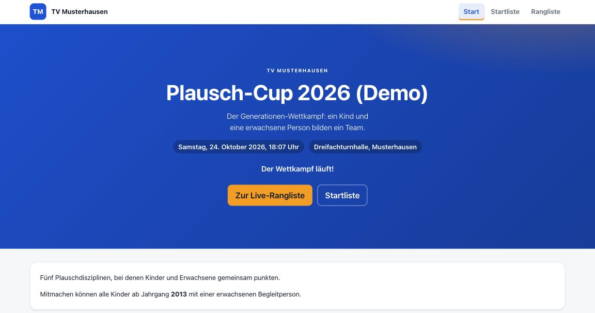
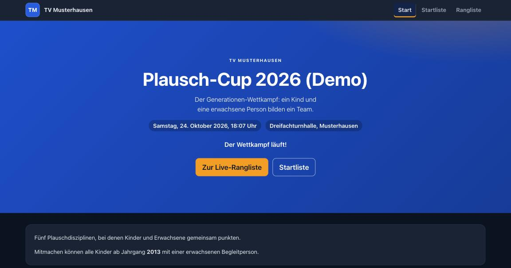
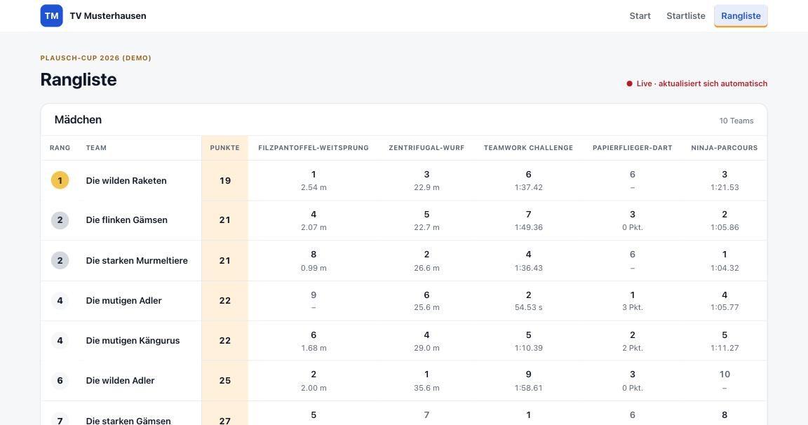
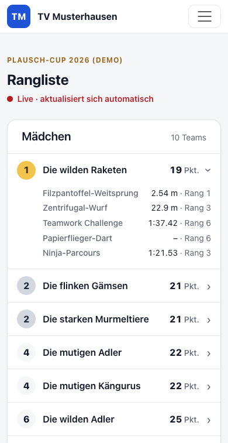
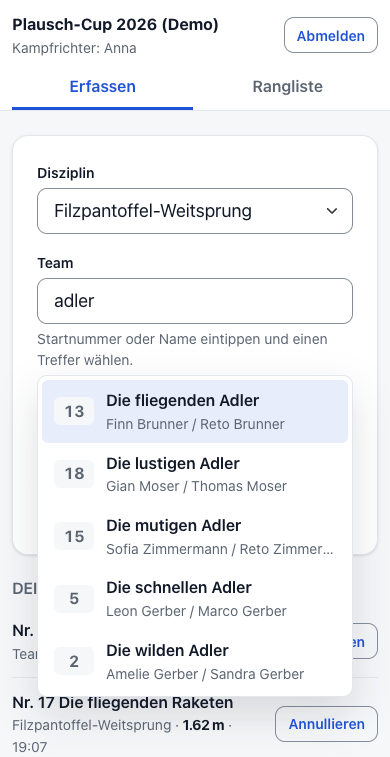
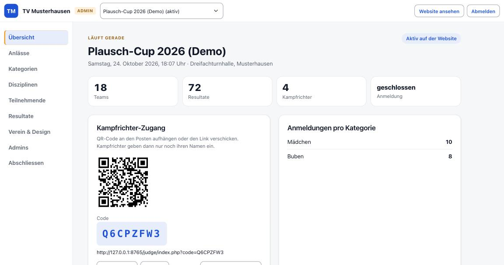
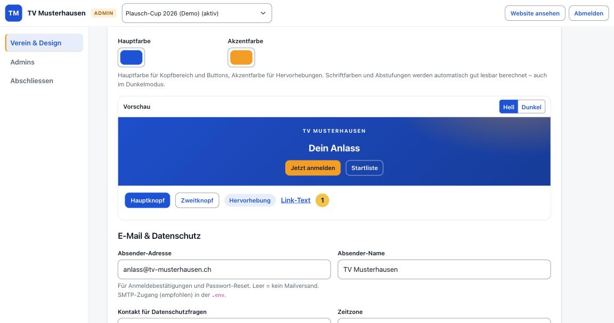

# event-rms

[](https://github.com/sgeissbu/event-rms/actions/workflows/tests.yml)
[](LICENSE)

**Anmeldung, Resultaterfassung und automatische Rangliste für Vereinsanlässe** – vom Plausch-Cup bis zum Jugendwettkampf.
Einzel oder Teams, mit eigenen Disziplinen, Kategorien und optionalem Handicap (z.B. für Alter oder Geschlecht).
Läuft auf gewöhnlichem Webhosting, wird per FTP hochgeladen und im Browser eingerichtet. Kein Programmieren, keine Kommandozeile.

> *English in short:* event-rms is a small PHP/MySQL web app for club events (registration, result entry by judges on their phones, automatic
> rank-point leaderboards with optional handicaps). It installs via FTP and a browser wizard on shared hosting (PHP ≥ 8.1). The UI is German.

Entstanden aus der Resultatverwaltung des «Oldies & Kids Cup» der Jugi Langenthal (Teams aus Kind und erwachsener Person) – verallgemeinert für alle Vereine.
Das Schwesterprojekt für laufende Vereinsmeisterschaften ist [jugi-rms](https://github.com/sgeissbu/jugi-rms).

**Status:** Version 0.9 (Beta). Die Wertung ist gegen eine echte Rangliste geprüft und von automatischen Tests abgedeckt; ein Einsatz im Ernstfall
steht noch aus. Bitte vor dem ersten grossen Anlass einmal mit Probedaten durchspielen (siehe [Ausprobieren](#ausprobieren)).

<p align="center">
  
  
</p>

## Was kann es?

- **Anmeldung** für Einzelpersonen oder Teams mit 2–10 Mitgliedern – Felder (Geschlecht, Jahrgang) pro Mitglied Pflicht, freiwillig oder ausgeblendet. Mit Einwilligung, Spam-Schutz und Bestätigungsmail.
- **Kampfrichter ohne Konto:** Code oder QR-Code scannen, Namen eingeben, loslegen. Erfassung fürs Handy gebaut: Suche nach Startnummer oder Name, Zeiten als `1:23.45` oder `83.45`, Teilmessungen, Korrektur der letzten Eingaben.
- **Automatische Rangliste** nach Rangpunkten, live während des Anlasses (aktualisiert sich selbst), mit Kategorien (z.B. «U10 Mädchen»), Handicap-Faktoren und Strafrang bei fehlenden Resultaten.
- **Admin-Bereich** für alles Laufende: Anlässe (auch als Vorlage kopieren), Disziplinen, Kategorien, Teilnehmende (nachmelden, ändern, CSV-Export), Resultate (annullieren, nachtragen), Admins.
- **Eigenes Aussehen in zwei Minuten:** zwei Farben, Logo, Fotos. Schriftfarben und Dunkelmodus werden automatisch lesbar berechnet; eine Vorschau zeigt das Ergebnis sofort und warnt bei schlecht lesbaren Farben.
- **Datenschutz eingebaut:** Namen auf den Listen voll, gekürzt oder nur als Startnummer; Jahrgang und E-Mail nie öffentlich; «Anlass anonymisieren» löscht alle Personendaten unwiderruflich und friert die Rangliste ein.
- **Druckbar:** Start- und Rangliste (Rangliste im Querformat). Ein PDF-Export ist geplant.

<p align="center">
  
  
  
</p>

## Installation

**Du brauchst:** Webhosting mit PHP 8.1 oder neuer (Erweiterungen `pdo_mysql`, `gd`, `mbstring` – bei fast allen Anbietern vorhanden),
eine **leere** MySQL- oder MariaDB-Datenbank und einen FTP-Zugang.

1. **Herunterladen:** Unter [Releases](https://github.com/sgeissbu/event-rms/releases) das ZIP laden und entpacken.
2. **Hochladen:** Alle Dateien per FTP in das gewünschte Verzeichnis (z.B. die Hauptseite oder ein Unterverzeichnis wie `anlass`). Empfohlen: eine eigene (Sub-)Domain mit HTTPS.
3. **Datenbank anlegen:** Im Panel des Hostings eine leere Datenbank samt Benutzer erstellen und Name, Benutzer und Passwort notieren.
4. **Einrichten:** Im Browser `https://deine-adresse/setup.php` öffnen. Der Assistent prüft den Server, testet die Datenbank, schreibt die Konfiguration (`.env`),
   legt die Tabellen an und fragt nach Vereinsname, Farben, deinem Admin-Zugang und dem ersten Anlass. Kann er die `.env` nicht selbst schreiben, zeigt er dir den Inhalt zum Hochladen an.
5. **Fertig.** Der Assistent sperrt sich danach selbst. Am Ende siehst du den **Kampfrichter-Code**.

Der Assistent prüft auch, ob die internen Ordner vor Zugriff geschützt sind. Das klappt auf Apache automatisch; bei **nginx** musst du den Zugriff auf
`src/`, `database/`, `tests/`, `tools/`, `lang/`, `templates/`, `vendor/`, `docs/` und Dateien wie `.env` in der Serverkonfiguration sperren (der Hoster kann helfen).

**E-Mail (empfohlen):** Für Anmeldebestätigungen und «Passwort vergessen» unter *Verein & Design* eine Absender-Adresse eintragen und in der `.env` die SMTP-Zugangsdaten
deines Postfachs (`SMTP_HOST`, `SMTP_USER`, `SMTP_PASS`, …) ergänzen. Ohne SMTP wird die einfache PHP-Funktion `mail()` versucht, die oft im Spam landet.

### Einstellungen in der `.env`

| Variable | Bedeutung |
|---|---|
| `DB_HOST`, `DB_PORT`, `DB_NAME`, `DB_USER`, `DB_PASS` | Datenbank (vom Assistenten gesetzt) |
| `APP_URL` | Öffentliche Adresse ohne Schrägstrich am Ende, z.B. `https://anlass.meinverein.ch`. Wird für Links in E-Mails verwendet; vom Assistenten gesetzt |
| `SMTP_HOST`, `SMTP_PORT`, `SMTP_USER`, `SMTP_PASS`, `SMTP_SECURE` | Mailversand (`ssl` für Port 465, `tls` für 587) |
| `APP_DEBUG` | `true` zeigt Fehler im Browser – nur zur Fehlersuche, nie im Betrieb |

### Aktualisieren

Neue Version herunterladen und die Dateien per FTP drüberkopieren – **ausser** `.env` und den Ordner `uploads/` (dort liegen deine Einstellungen, Logo und Fotos).
Änderungen an der Datenbank werden beim ersten Aufruf automatisch eingespielt. Vorher ein Backup der Datenbank ist trotzdem eine gute Idee.

## Der Weg zum ersten Anlass

Nach der Einrichtung im Admin-Bereich (`/admin/`):

1. **Anlass** – Texte (Beschreibung, Zeitplan, «Mitnehmen»), Datum, Ort, Anmeldeschluss. Einzel oder Team, Angaben pro Mitglied, Handicap ja/nein.
2. **Disziplinen** – Name, Einheit, Messart (Zahl oder Zeit), wer gewinnt (höher/tiefer), optional Teilmessungen und Handicap-Faktoren. Eine Beispielrechnung zeigt die Wirkung.
3. **Kategorien** (optional) – z.B. «Mädchen/Buben» oder nach Jahrgang. Sie werden bei der Anmeldung automatisch zugeteilt.
4. **Verein & Design** – Farben, Logo, Fotos, Absender-Adresse, Kontakt für Datenschutzfragen.
5. **Probelauf** – selbst anmelden, als Kampfrichter ein paar Resultate erfassen, Rangliste ansehen; danach die Probedaten unter *Teilnehmende* löschen.
6. **Kampfrichter-Zugang** – auf der Übersicht den QR-Code ausdrucken oder den Link verschicken.

**Am Anlass:** Kampfrichter scannen den QR-Code und tragen Resultate ein; die Rangliste auf Bildschirm oder Handy aktualisiert sich selbst.
Fehler? Kampfrichter können eigene Eingaben 15 Minuten lang annullieren, Admins jederzeit (unter *Resultate*) – auch nachträglich mit Zettel nachtragen.

**Danach:** *Abschliessen* → Archivieren (Anmeldung und Kampfrichter-Zugang schliessen, Rangliste bleibt sichtbar) und später **Anonymisieren**
(löscht Namen, Jahrgänge, E-Mails; die Rangliste bleibt als eingefrorener Stand).

<p align="center">
  
  
</p>

## Wie wird gewertet?

Pro Disziplin bekommt jedes Team (oder jede Person) einen **Rang** – Rang 1 = 1 Punkt, Rang 2 = 2 Punkte usw.; bei Gleichstand teilen sich Teams den Rang.
Wer in einer Disziplin kein Resultat hat, erhält «Anzahl Teams mit Resultat + 1» Punkte. Die Punkte aller Disziplinen werden addiert – **wer am wenigsten hat, gewinnt**.
Rangpunkte machen so verschiedene Disziplinen (Weite, Zeit, Punkte) ohne Umrechnung vergleichbar.

Mit **Handicap** werden Messwerte vor dem Ranking ausgeglichen, z.B. für jüngere Kinder oder für Frauen. Die Faktoren sind immer **Vorteile ab 1**
(1.2 = 20 % Vorteil): Bei «höher ist besser» wird der Wert mit dem Faktor multipliziert, bei «tiefer ist besser» (Zeit) dadurch geteilt. Angezeigt werden immer die echt gemessenen Werte.
Mehr dazu in der [Architektur-Beschreibung](docs/ARCHITEKTUR.md).

## Datenschutz

Ein Anlass mit Kindern verarbeitet Personendaten – **die Verantwortung dafür trägt der Verein**. event-rms hilft dabei (Einwilligung bei der Anmeldung, Namensanzeige einstellbar,
Jahrgang und E-Mail nie öffentlich, Anonymisieren), ersetzt aber keine Rechtsberatung. Bitte den Einwilligungstext prüfen und einen Ansprechpartner für Datenschutzfragen eintragen.
Fotos von Personen im Kopfbereich nur mit Einwilligung verwenden. Werden Daten eines Anlasses nicht mehr gebraucht: anonymisieren.

## Ausprobieren

Mit Kommandozeile und PHP lässt sich ein Anlass mit erfundenen Teams und Resultaten erzeugen:

```bash
php tools/seed-demo.php --phase=live      # oder: upcoming | past
```

Der Befehl legt den Demo-Anlass «Plausch-Cup (Demo)» an und macht ihn zum aktiven Anlass. Ohne Kommandozeile: einen Probe-Anlass im Admin-Bereich anlegen und ein paar Anmeldungen von Hand erfassen.

## Entwicklung

```bash
git clone https://github.com/sgeissbu/event-rms.git && cd event-rms
cp .env.example .env            # DB-Zugang eintragen (leere Datenbank), ggf. TEST_DB_NAME für Integrationstests
php -S 127.0.0.1:8765           # dann http://127.0.0.1:8765/setup.php
php tests/run.php               # alle Tests (eigener Runner, keine Abhängigkeiten)
```

- Architektur und Entwurfsentscheide: [docs/ARCHITEKTUR.md](docs/ARCHITEKTUR.md)
- Beiträge, Fehlermeldungen und Ideen sind willkommen – siehe [CONTRIBUTING.md](CONTRIBUTING.md). Sicherheitsprobleme bitte vertraulich melden: [SECURITY.md](SECURITY.md).
- Die Tests laufen auf PHP 8.1 bis 8.4 (GitHub Actions). Integrationstests brauchen eine leere Test-Datenbank, deren Name «test» enthält – sie wird bei jedem Lauf geleert.

## Bekannte Einschränkungen

- Nur deutsche Oberfläche (Texte in `lang/de.php`).
- Kein PDF-Export (Rangliste lässt sich drucken); keine Urkunden.
- Ein Anlass hat genau ein Format (Einzel *oder* Team); für beides am selben Tag zwei Anlässe anlegen.
- Logo mit dunklem, transparentem Hintergrund ist im Dunkelmodus schwer erkennbar – dann ein Logo mit hellem Rand oder eigener Fläche verwenden.
- Kein Offline-Betrieb: Die Kampfrichter brauchen Netz (Mobilfunk genügt).

## Lizenz und Mitgelieferte Software

[MIT](LICENSE) – frei nutz- und anpassbar. Mitgeliefert: [Bootstrap 5.3](https://getbootstrap.com) (MIT), [PHPMailer 7](https://github.com/PHPMailer/PHPMailer) (LGPL-2.1),
[qrcode-generator](https://github.com/kazuhikoarase/qrcode-generator) (MIT) – die jeweiligen Lizenzen liegen bei den Dateien.
